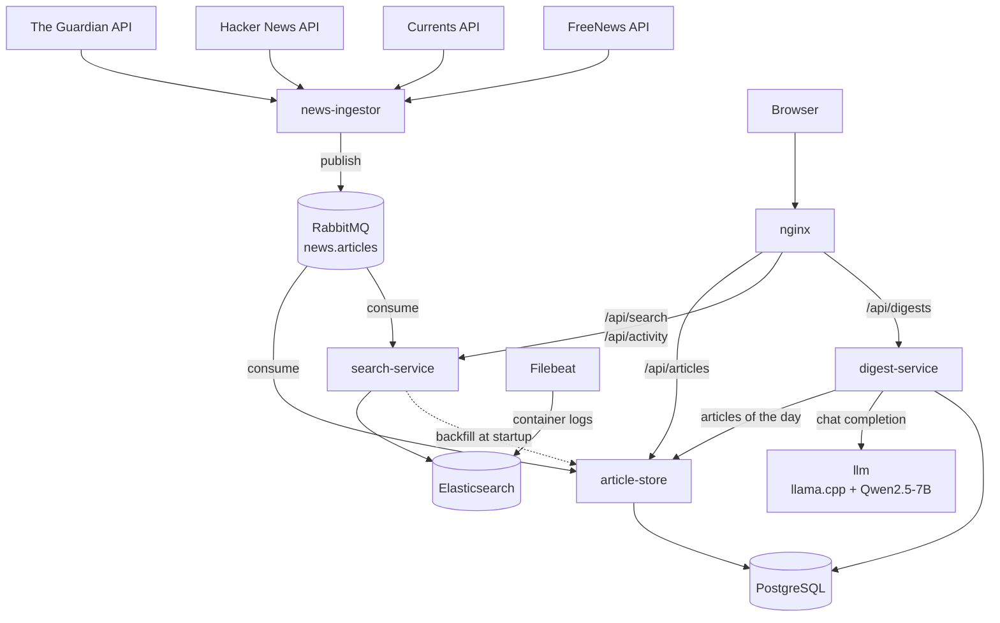

# Forest News

[![CI]](https://github.com/IliasIosifidis/Forest-News/actions/workflows/ci.yml)

**Live demo:** [forest-news.onca-pierce.ts.net](https://forest-news.onca-pierce.ts.net/) ·
[API docs (Swagger UI)](https://forest-news.onca-pierce.ts.net/swagger-ui/index.html)

A news aggregator that collects articles from public news APIs and distributes them through
**RabbitMQ** to independent consumers: one stores them, one makes them searchable. Once a day, a
self-hosted language model turns the day's articles into a short digest.
Built to explore event-driven design, and the tooling that keeps it running.

**Stack:** Java 25 · Spring Boot 4.1 · Spring AI · RabbitMQ · PostgreSQL · Flyway · Elasticsearch ·
llama.cpp · Vue 3 · nginx · Docker Compose · Filebeat · Kibana · JUnit 5 · Testcontainers ·
GitHub Actions

## Architecture

The ingestor publishes each article once to a topic exchange. Every consumer owns its own queue,
so adding a consumer never changes the producer: the search-service was added later without
touching the ingestor or the article store. Services never read each other's databases; they talk
through messages or HTTP APIs.

## news-ingestor

A **Spring Boot** service that:

- Polls public news sources (the Guardian, Hacker News, Currents, FreeNews) on a schedule
- Maps each source's format into one common **Article** model, with one adapter per source
- Publishes new articles to **RabbitMQ** with routing keys like `article.guardian`
- Isolates failures at three levels: a misconfigured source disables itself at startup instead
  of crashing the app; a failing or hanging source is skipped (HTTP timeouts) without affecting
  the others; a malformed article is skipped without losing the rest of its batch
- Deduplicates articles before publishing, using a bounded in-memory **Caffeine** cache
- Delivers **at least once**: if publishing fails, the article is forgotten by the cache and
  retried on the next cycle

*Design note:* the dedup cache is lost on restart, so a restart re-publishes one batch.
That's acceptable because deduplication here is only an optimization: the consumers process
articles idempotently, so duplicates are harmless. This avoids running **Redis**; a shared store
would become necessary when running several ingestor instances.

## article-store

A **Spring Boot** service that consumes articles from RabbitMQ, stores them in **PostgreSQL**,
and serves them through a paged **REST API**:

- Consumes from its own queue, bound to the `news.articles` topic exchange
- Stores articles **idempotently**: a unique constraint plus `INSERT ... ON CONFLICT DO NOTHING`,
  so redelivered or duplicate messages are absorbed atomically, with no race conditions
- Handles failures with **retries and exponential backoff**, then moves messages that still fail
  to a **dead-letter queue**, instead of redelivering them forever
- Manages the schema with versioned **Flyway** migrations; Hibernate only validates it at startup
- Exposes `GET /api/articles` (newest first, paged, filterable by source or by a `from`/`to`
  window on the time each article was received) and `GET /api/articles/by-key`, documented with
  **OpenAPI / Swagger UI**

*Design note:* duplicates are expected by design. RabbitMQ delivers at least once (a consumer can
crash after committing but before acknowledging), and the ingestor re-publishes after a restart,
so the guarantee lives in the database. A check-then-insert would race under concurrent consumers;
`ON CONFLICT` makes "insert if absent" one atomic operation. The trade-off is PostgreSQL-specific SQL.

## search-service

A **Spring Boot** service that owns **Elasticsearch** and keeps a searchable copy of the articles:

- Indexes every article from its own RabbitMQ queue (with its own retries and dead-letter queue)
- Uses the article key (`source:externalId`) as the document ID, so re-indexing is idempotent
- **Backfills** on startup through the article store's API when the index is behind, with retries;
  it never reads the article store's database directly
- `GET /api/search`: search-as-you-type on titles (`search_as_you_type` field, `bool_prefix`
  queries), typo tolerance (fuzziness), title matches boosted over summary matches,
  and filtering by source
- `GET /api/activity`: the latest pipeline activity per service, read from the shipped logs

*Design note:* the index is a **read model**: PostgreSQL stays the source of truth, and the index
can be deleted and rebuilt from it at any time. RabbitMQ doesn't replay consumed messages, which is
why a new consumer needs a backfill path.

## digest-service

A **Spring Boot** service that writes a daily digest of the news with a **self-hosted language
model**, so no external AI service or API key is involved:

- Runs every day at 21:00 Athens time and covers the articles received in the previous 24 hours
  (a half-open `[from, to)` window, so every article belongs to exactly one digest, including on
  the days the clocks change)
- Selects its input before calling the model: only recently published articles, a fair share per
  source so one busy source can't dominate, and a hard cap that keeps the prompt inside the
  model's context window; summaries are stripped of HTML and shortened
- Calls the model through **Spring AI**; the model runs in its own container on **llama.cpp**
  (Qwen2.5-7B-Instruct, 4-bit quantized), behind an OpenAI-compatible API
- Stores one digest per day in its own PostgreSQL schema (Flyway); re-running a day replaces its
  digest (`INSERT ... ON CONFLICT DO UPDATE`)
- Exposes `GET /api/digests/latest`; a manual trigger for regenerating a given day is only
  reachable from the server itself

*Design note:* the model container is stateless and knows nothing about the system: it receives
the instructions and the articles in each request and returns text. That keeps it replaceable (a
different model is a configuration change, and a hosted provider would mostly be a different base
URL) and isolated: if the model is down or slow, only the digest is affected.

## Frontend

A **Vue 3** single-page app (Vite, Tailwind CSS, Pinia): the latest articles per source, a search
box with autocomplete (debounced), article pages, the daily digest (labeled as AI-generated), and
an animated activity panel showing the pipeline at work. Built AI-assisted with Claude Code; I
defined the architecture and the API contracts, and reviewed every change.

**nginx** is the single entry point: it serves the built frontend, and routes `/api/articles` to
the article store, `/api/search` and `/api/activity` to the search-service, and `/api/digests` to
the digest-service. Everything shares one origin, so no CORS configuration is needed.

## Testing

Each service is tested at the level where a mistake would actually show up:

- **Unit tests** (JUnit 5, AssertJ, Mockito) for decision logic: deduplication, retrying a failed
  publish, source adapters against a fake HTTP server (`MockRestServiceServer`), the digest's
  article selection and its time window
- **Spring slice tests** for what the framework does around the code: routing, request
  parameters, paging defaults and JSON with `@WebMvcTest`; queries and migrations with
  `@DataJpaTest` / `@JdbcTest`
- **Integration tests** with **Testcontainers** against real PostgreSQL, RabbitMQ and
  Elasticsearch: `ON CONFLICT` and the time-window queries, the full path from the exchange to the
  database, the JSON contract between producer and consumers, and search relevance (prefix
  matching, typo tolerance, boosting, filters)

The language model is never called in tests: it is replaced by a stub, and the tests check the
code around it (what is sent, how the answer is cleaned and stored).

## CI/CD

A **GitHub Actions** workflow runs on every push and pull request:

1. **Build and test** each service in parallel (a matrix job; `./mvnw verify`, including the
   Testcontainers tests), and build the frontend
2. **Publish images** once everything is green: each service's Docker image is pushed to the
   **GitHub Container Registry**, tagged with the commit's short SHA and `latest`

Deployment is **continuous delivery**: the server pulls the tested images instead of building them
(`./deploy.sh`), and rolling back is one command with an earlier tag
(`IMAGE_TAG=<sha> ./deploy.sh`). Infrastructure images are pinned to exact versions, so a deploy
only changes what was meant to change.

## Observability

- The services log structured JSON (**ECS** format); **Filebeat** ships the containers' logs into
  Elasticsearch, kept for 14 days by an index lifecycle policy; **Kibana** is available privately
- Every service exposes metrics through **Micrometer**; **Prometheus** scrapes them every 15 seconds
  (kept for 15 days), and **Grafana** shows them in dashboards (JVM memory, GC, threads, HTTP
  traffic and latency per service); its data source is provisioned from the repo
- The activity panel only shows log lines written to a dedicated `activity` logger, filtered
  server-side, so raw logs are never exposed publicly

## Running it

Requires **Docker**. Copy `.env.example` to `.env`, and add your free API keys
([the Guardian](https://open-platform.theguardian.com/access/), Currents, FreeNews). Then:

    docker compose --profile apps --profile llm up -d --build

This builds and starts everything: the services, RabbitMQ, PostgreSQL, Elasticsearch, Filebeat,
Kibana, nginx and the model server. On first start the model server downloads the model
(about 4.7 GB); it needs roughly 9 GB of RAM. Without `--profile llm`, everything except the
digest runs.

- Frontend: http://localhost:8090
- Swagger UI: http://localhost:8090/swagger-ui/index.html
- Kibana: http://localhost:5601

For development, `docker compose up -d` starts only the infrastructure, and the services run
from the IDE. Tests: `./mvnw verify` in a service's folder (Docker must be running).

## Deployment

The live demo runs on a **self-managed Linux server** with **Docker Compose**: restart policies,
log rotation, memory and CPU limits per container (JVM heaps sized to the limits), and every port
bound to localhost only. Public HTTPS traffic arrives through a **Tailscale Funnel** tunnel to
nginx, so no inbound ports are open on the network; administration happens over SSH inside the
private tailnet. Small scripts cover the routine tasks: deploying, opening a database shell,
readable container logs, a Kibana tunnel, and regenerating a day's digest.
PostgreSQL is backed up nightly with `pg_dump`, kept for 14 days, copied off the server, and restores have been tested.
The server's setup is code: an **Ansible** playbook (`infra/`) installs Docker and Tailscale,
clones the repo, schedules the nightly database backup, and places the `.env`, which is stored
in the repo encrypted with **Ansible Vault**. Rebuilding the server is one command plus a
database restore.

## Known trade-offs

- Elasticsearch runs without security, acceptable only because it's reachable solely from inside
  the server
- The article store keeps the first version of an article (`DO NOTHING`), while the index keeps
  the latest one; an edited headline could differ between the two
- Search tolerates typos in every word except the last one, which is matched as a prefix
  (the usual behavior for search-as-you-type)
- The digest comes from a small local model, which can merge or misstate stories; it is labeled
  as AI-generated, and its input is capped, so on busy days it covers a selection of the articles
- Credentials for local infrastructure are in the compose file; production secrets would move to
  `.env` or Docker secrets

## Roadmap
- Alerting on the metrics (service down, dead-lettered messages, low disk), with notifications
- Automated deployment after a green build (continuous deployment)
- Kubernetes manifests for the stack (in progress on the `k8s` branch)
- Non-root containers
- Publisher confirms, for guaranteed delivery to the broker
- Correlation IDs / distributed tracing across the services
- Links from each digest story to its source articles
- Detection of near-duplicate stories across sources

See the [open issues](https://github.com/IliasIosifidis/Forest-News/issues) for details.