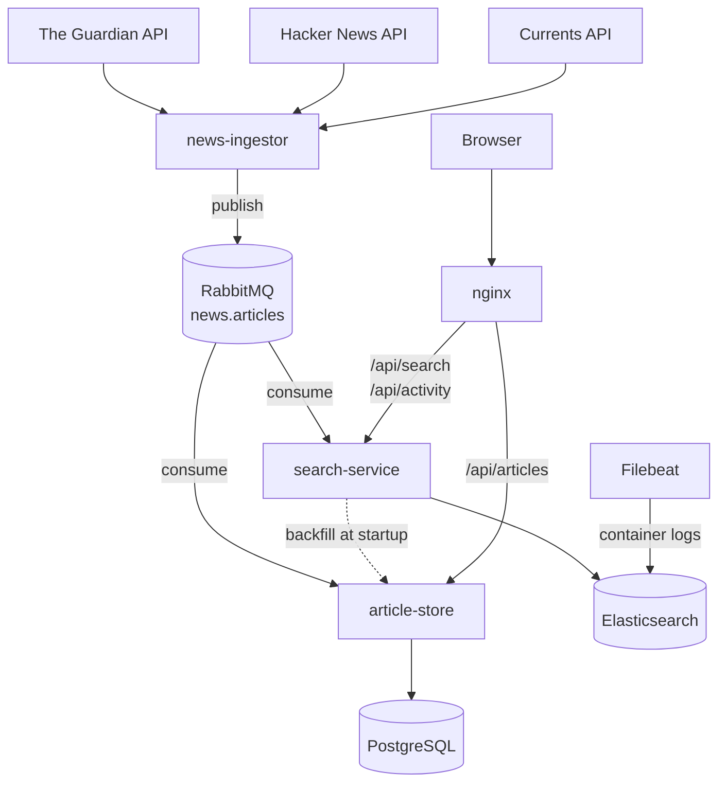

# Forest News

**Live demo:** [forest-news.onca-pierce.ts.net](https://forest-news.onca-pierce.ts.net/) ·
[API docs (Swagger UI)](https://forest-news.onca-pierce.ts.net/swagger-ui/index.html)

A news aggregator that collects articles from public news APIs and distributes them through
**RabbitMQ** to independent consumers: one stores them, one makes them searchable.
Built to explore event-driven design.

**Stack:** Java 25 · Spring Boot 4.1 · RabbitMQ · PostgreSQL · Flyway · Elasticsearch ·
Vue 3 · nginx · Docker Compose · Filebeat · Kibana

## Architecture

The ingestor publishes each article once to a topic exchange. Every consumer owns its own queue,
so adding a consumer never changes the producer: the search-service was added later without
touching the ingestor or the article store.

## news-ingestor

A **Spring Boot** service that:

- Polls public news sources (the Guardian, Hacker News, Currents) on a schedule
- Maps each source's format into one common **Article** model, with one adapter per source
- Publishes new articles to **RabbitMQ** with routing keys like `article.guardian`
- Isolates failures at three levels: a misconfigured source disables itself at startup instead
  of crashing the app; a failing or hanging source is skipped (HTTP timeouts) without affecting
  the others; a malformed article is skipped without losing the rest of its batch
- Deduplicates articles before publishing, using a bounded in-memory **Caffeine** cache
- Delivers **at least once**: if publishing fails, the article is forgotten by the cache and
  retried on the next cycle
- The Guardian adapter is unit-tested offline with **MockRestServiceServer** (the tests caught
  a bug where one malformed date discarded a whole batch)

*Design note:* the dedup cache is lost on restart, so a restart re-publishes one batch.
That's acceptable because deduplication here is only an optimization: the consumers process
articles idempotently, so duplicates are harmless. This avoids running **Redis**; a shared store
would become necessary when running several ingestor instances.

## article-store

A **Spring Boot** service that consumes articles from RabbitMQ, stores them in **PostgreSQL**,
and serves them through a paged **REST API**:

- Consumes from its own queue, bound to the `news.articles` topic exchange
- Stores articles **idempotently**: a unique constraint plus `INSERT ... ON CONFLICT DO NOTHING`,
  so redelivered or duplicate messages are absorbed atomically, with no race conditions
- Handles failures with **retries and exponential backoff**, then moves messages that still fail
  to a **dead-letter queue**, instead of redelivering them forever
- Manages the schema with versioned **Flyway** migrations; Hibernate only validates it at startup
- Exposes `GET /api/articles` (newest first, paged, filterable by source) and
  `GET /api/articles/by-key`, documented with **OpenAPI / Swagger UI**

*Design note:* duplicates are expected by design. RabbitMQ delivers at least once (a consumer can
crash after committing but before acknowledging), and the ingestor re-publishes after a restart,
so the guarantee lives in the database. A check-then-insert would race under concurrent consumers;
`ON CONFLICT` makes "insert if absent" one atomic operation. The trade-off is PostgreSQL-specific SQL.

## search-service

A **Spring Boot** service that owns **Elasticsearch** and keeps a searchable copy of the articles:

- Indexes every article from its own RabbitMQ queue (with its own retries and dead-letter queue)
- Uses the article key (`source:externalId`) as the document ID, so re-indexing is idempotent
- **Backfills** on startup through the article store's API when the index is behind, with retries;
  it never reads the article store's database directly
- `GET /api/search`: search-as-you-type on titles (`search_as_you_type` field, `bool_prefix`
  queries), typo tolerance (fuzziness), title matches boosted over summary matches,
  and filtering by source
- `GET /api/activity`: the latest pipeline activity per service, read from the shipped logs

*Design note:* the index is a **read model**: PostgreSQL stays the source of truth, and the index
can be deleted and rebuilt from it at any time. RabbitMQ doesn't replay consumed messages, which is
why a new consumer needs a backfill path.

## Frontend

A **Vue 3** single-page app (Vite, Tailwind CSS, Pinia): the latest articles per source, a search
box with autocomplete (debounced), article pages, and an animated activity panel showing the
pipeline at work. Built AI-assisted with Claude Code; I defined the architecture and the API
contracts, and reviewed every change.

**nginx** is the single entry point: it serves the built frontend, and routes `/api/articles` to
the article store and `/api/search` and `/api/activity` to the search-service. Everything shares
one origin, so no CORS configuration is needed.

## Observability

- The services log structured JSON (**ECS** format) when running in containers
- **Filebeat** ships the containers' logs into Elasticsearch; **Kibana** is available privately,
  through an SSH tunnel
- The activity panel only shows log lines written to a dedicated `activity` logger, filtered
  server-side, so raw logs are never exposed publicly

## Running it

Requires **Docker**. Copy `.env.example` to `.env`, and add your free API keys
([the Guardian](https://open-platform.theguardian.com/access/), Currents). Then:

    docker compose --profile apps up -d --build

This builds and starts everything: the services, RabbitMQ, PostgreSQL, Elasticsearch, Filebeat,
Kibana and nginx.

- Frontend: http://localhost:8090
- Swagger UI: http://localhost:8090/swagger-ui/index.html
- Kibana: http://localhost:5601

For development, `docker compose up -d` starts only the infrastructure, and the services run
from the IDE.

## Deployment

The live demo runs on a **self-managed Linux server** with **Docker Compose**: restart policies,
log rotation, memory limits per container (JVM heaps sized to the limits), and every port bound to
localhost only. Public HTTPS traffic arrives through a **Tailscale Funnel** tunnel to nginx, so no
inbound ports are open on the network; administration happens over SSH inside the private tailnet.

## Known trade-offs

- Elasticsearch runs without security, acceptable only because it's reachable solely from inside
  the server
- The article store keeps the first version of an article (`DO NOTHING`), while the index keeps
  the latest one; an edited headline could differ between the two
- Credentials for local infrastructure are in the compose file; production secrets would move to
  `.env` or Docker secrets

## Roadmap

- Integration tests with Testcontainers (PostgreSQL, Elasticsearch)
- Publisher confirms, for guaranteed delivery to the broker
- Correlation IDs / distributed tracing across the services
- User-submitted stories as a source of their own, published to the same exchange
- Detection of near-duplicate stories across sources
- Log retention policy, non-root containers, health endpoints

See the [open issues](https://github.com/IliasIosifidis/news-aggregator/issues) for details.